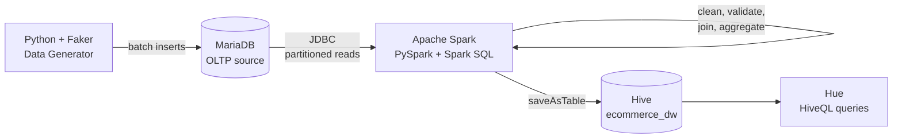

# E-Commerce Batch ETL Pipeline: MariaDB → Spark → Hive

A batch ETL pipeline that moves data from an e-commerce database (OLTP) into a Hive data warehouse with Apache Spark. It generates a realistic dataset of **3.1M+ rows**, extracts it from MariaDB over JDBC with parallel partitioned reads, then cleans and validates it, builds sales analytics tables, and writes them to Hive on Hadoop.

## Architecture



## Tech Stack

| Layer | Tools |
|---|---|
| Data generation | Python, Faker, mysql-connector-python |
| Source database | MariaDB (MySQL-compatible) |
| Processing | Apache Spark (PySpark, Spark SQL), JDBC |
| Data warehouse | Apache Hive on Hadoop (HDFS) |
| Querying | Hue (HiveQL on MapReduce) |
| Environment | Jupyter Notebook |

## Dataset

The generator (`01_generate_data.ipynb`) builds a normalized e-commerce schema and loads it with batched inserts of 5,000 rows each.

| Table | Rows | Description |
|---|---:|---|
| `customers` | 100,000 | Name, email, country, city, signup date |
| `products` | 20,000 | Name, category (10 categories), price, stock |
| `orders` | 500,000 | Customer, timestamp (2-year window), status, shipping country |
| `order_items` | 2,000,000 | Order, product, quantity, unit price |
| `payments` | 500,000 | Method, status, date, amount |
| **Total** | **3,120,000** | |

Customers come from 6 markets: Egypt, Saudi Arabia, UAE, Jordan, Kuwait and Qatar.

## Pipeline Steps

### 1. Extract
- Read all 5 tables from MariaDB through the Spark JDBC connector.
- Large tables (`orders`, `order_items`, `payments`) use **partitioned parallel reads** (`partitionColumn`, `lowerBound`, `upperBound`, `numPartitions`) so Spark pulls data over 4–8 connections at once instead of one.
- Set `fetchsize = 10000` to cut down network round trips.

### 2. Transform
- **Cleaning:** remove duplicates on primary keys, and drop rows with nulls in required columns.
- **Validation:** keep only rows with valid dates, positive prices and quantities, and positive payment amounts.
- **Modeling:** join `orders`, `order_items`, `products` and `customers` into one sales fact dataset, and compute `total_sales = quantity × unit_price`.
- **Aggregations:**
  - Sales by country, by category, and by day, month and year
  - Daily sales: orders, quantity, revenue and average order value
  - Customer sales: orders, quantity and total spending per customer
  - Product sales: quantity and revenue per product

### 3. Load
The pipeline writes 4 tables to the Hive database `ecommerce_dw`:

| Hive table | Grain |
|---|---|
| `fact_sales` | One row per order item, joined with order, product and customer details |
| `daily_sales` | One row per day |
| `customer_sales` | One row per customer |
| `product_sales` | One row per product |

## Sample Results

| Metric | Value |
|---|---:|
| Orders with items | 490,997 |
| Active customers | 99,314 |
| Units sold | 5,998,053 |
| Total sales | 6.02B |
| Average order value | 12,259.51 |

See the [Screenshots](#screenshots) section for the full outputs.

## How to Run

**Prerequisites:** Hadoop, Hive metastore, Apache Spark with Hive support, MariaDB, Python 3, and the [MariaDB JDBC driver](https://mariadb.com/downloads/connectors/connectors-data-access/java8-connector/) (`mariadb-java-client-3.3.3.jar`).

1. Start HDFS, the Hive metastore and MariaDB.
2. Set the database settings as environment variables (see Configuration).
3. Run `01_generate_data.ipynb` to create the `ecommerce` database and load 3.1M rows.
4. Update the JDBC jar path in `02_etl_spark.ipynb`, then run it.
5. Check the output in Hive:
   ```sql
   SHOW TABLES IN ecommerce_dw;
   SELECT * FROM ecommerce_dw.daily_sales LIMIT 10;
   ```

## Configuration

Both notebooks read their settings from environment variables:

| Variable | Default | Used by |
|---|---|---|
| `DB_HOST`, `DB_PORT`, `DB_NAME` | `localhost`, `3306`, `ecommerce` | Generator |
| `DB_URL` | `jdbc:mysql://localhost:3306/ecommerce` | ETL |
| `DB_USER`, `DB_PASSWORD` | `student`, empty | Both |
| `JDBC_JAR` | Path to `mariadb-java-client-3.3.3.jar` | ETL |

## Performance Notes

- Partitioned JDBC reads split each large table across 4 to 8 parallel connections.
- The joined `sales` dataset is cached, so the yearly, daily, customer and product aggregations reuse it instead of re-reading MariaDB each time.

## Screenshots

### . Querying the warehouse in Hue
The Hive query returns the same total sales as Spark, which confirms the load is complete.
![Hue total sales]


![Hue daily sales]


## Project Structure

```
.
├── 01_generate_data.ipynb              # Synthetic data generator → MariaDB
├── 02_etl_spark.ipynb                  # Spark ETL: MariaDB → Hive
├── images/                             # Screenshots of each stage
└── README.md
```


